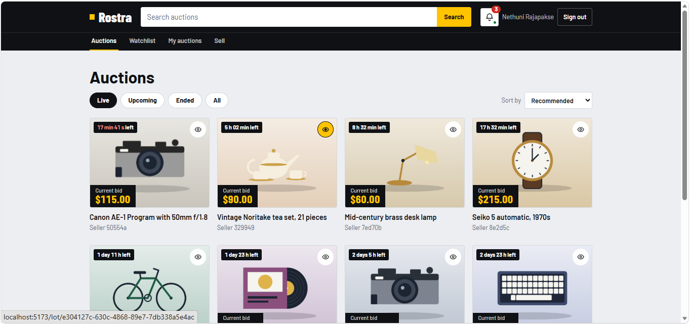
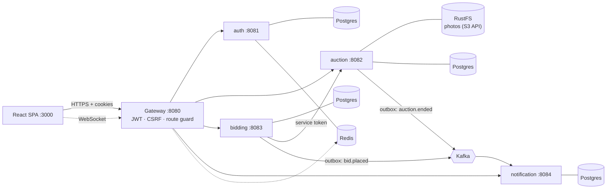

# Rostra

[](https://github.com/nethunirajapakse/rostra/actions/workflows/ci.yml)

A real-time auction platform built as event-driven microservices. Sellers list items, bidders compete, and prices and notifications update live.

Built to practise reliability patterns: not losing events when Kafka is down, not processing them twice, and not selling an item to two people.

**Stack:** Java 21 · Spring Boot 3 · Spring Cloud Gateway · Kafka · PostgreSQL 16 · Redis · WebSocket · React 19 · TypeScript · Tailwind 4 · TanStack Query

## Screenshots



<!-- Add more below once captured, for example:


-->

## Features

- **Live bidding.** Bids update the price on every open page over WebSocket; losing bidders and sellers get notifications.
- **Photos.** Sellers upload up to 5 photos per auction (JPEG, PNG or WebP, 5 MB each), reorder them and pick the cover.
- **Watchlist.** Watch any auction and follow it from one page.
- **Search, sort and filter** by status, keyword and price.
- **Seller tools.** Create auctions, manage photos, and see your own listings.

## Architecture



Each service owns its own database (`rostra_auth`, `rostra_auction`, `rostra_bidding`, `rostra_notification`). Services use HTTP for commands and Kafka for events.

## Authentication

- Sign-in sets two `HttpOnly`, `SameSite=Strict` cookies: a 15-minute access JWT and a 7-day refresh JWT. Refresh rotates the pair; sign-out denylists the access token in Redis.
- The gateway validates the cookie, drops any `Authorization` header, and enforces double-submit CSRF (`XSRF-TOKEN` cookie, `X-XSRF-TOKEN` header) on writes.
- Services re-verify the token locally and never call auth-service.
- Anonymous requests get `401`, forbidden ones `403`. Unauthenticated WebSocket upgrades get `401`.

## Reliability patterns

| Problem | Solution |
|---|---|
| Kafka is down when a bid is placed | **Transactional outbox**: the event is saved with the bid in one transaction, then published by a poller. Also used for `auction.ended`. |
| Kafka delivers an event twice | Consumers **dedupe** on the source event id. |
| Two bids at the same moment | **Optimistic locking** on the auction, with a retry. An integration test fires 50 simultaneous bids and checks that exactly one wins ([how it works](platform/backend/bidding-service/src/test/java/com/rostra/bidding/concurrency/README.md)). |
| Auction service is slow or failing | **Resilience4j** circuit breaker and retry. |
| Redis is down | Gateway checks **fail open** behind a circuit breaker. |
| Internal endpoint called from outside | Gateway blocks it, and it only accepts a short-lived `SERVICE` token. |

`scripts/demo-kafka-outage.sh` stops Kafka, places bids, restarts Kafka, and shows that nothing was lost.

## Photo uploads

Photos go to an S3-compatible bucket (RustFS locally, any S3 service in production), but the bucket stays private: the auction service streams each image itself from `/auctions/{id}/images/{imageId}/content` with long-lived cache headers.

- The file type is read from the file's magic bytes, not the filename or `Content-Type`, so a renamed file is rejected.
- The 5-photo limit is enforced under a row lock, so concurrent uploads cannot exceed it.
- Storage is cleaned up after the database transaction completes, so a rollback does not leave orphaned files.
- Lists load photos and the viewer's watched ids with one batch query each, so there is no N+1.

## Running it

Requires Docker with Compose (about 4 GB of free memory for the full stack).

```bash
docker compose --profile app up -d --build   # everything; the first build takes a few minutes
```

Then open **http://localhost:3000**. The API is also on `http://localhost:8080`. Wait until `docker compose ps` shows the gateway as healthy, then load demo data:

```bash
bash scripts/seed.sh             # 8 users, 16 auctions with photos, bids and watchlists; sign in as demo@rostra.dev / Rostra@Demo1
```

A throwaway signing secret is built into `docker-compose.yml` so this works with no setup. Set your own with `JWT_SECRET=... docker compose --profile app up -d`. Auction photos are stored in RustFS, an S3-compatible object store (console at http://localhost:9001/rustfs/console/, access key `rostra-dev-key`, secret `rostra-dev-secret-0123`). Kafka UI is optional: `docker compose --profile tools up -d kafka-ui` (http://localhost:8090).

`docker compose --profile app down -v` stops everything and deletes the data.

### Developing from an IDE

```bash
docker compose up -d                                  # infrastructure only: Postgres, Redis, Kafka, RustFS
export JWT_SECRET="$(openssl rand -base64 48)"        # same value for the gateway and every service (see .env.example)
cd platform/backend/<name> && mvn spring-boot:run     # gateway, auth, auction, bidding, notification
cd platform/frontend && npm install && npm run dev    # http://localhost:5173
```

In IntelliJ, set `JWT_SECRET` in each run configuration. The Vite dev server (and nginx in the container) proxies API and WebSocket paths to the gateway, so the browser sees a single origin.

## Testing

```bash
# Unit and integration tests, one service at a time. The integration tests start Postgres with
# Testcontainers, so Docker must be running.
cd platform/backend/<service> && mvn verify

# End-to-end checks against the running stack
bash scripts/smoke-flow.sh          # whole platform through the gateway
bash scripts/demo-kafka-outage.sh   # outbox demo
```

GitHub Actions runs `mvn verify` for every service, plus the frontend lint and build, on each push and pull request.

## Known limitations

- The schema comes from Hibernate `ddl-auto=update`; Flyway migrations would be the proper fix.
- One shared HMAC secret signs all tokens; production would use asymmetric keys and mTLS.
- WebSocket sessions are in memory, so notification-service runs as a single instance.
- No payments: winning an auction produces a notification, not a checkout.
- Photos are served through the auction service; at scale they would go behind a CDN.
