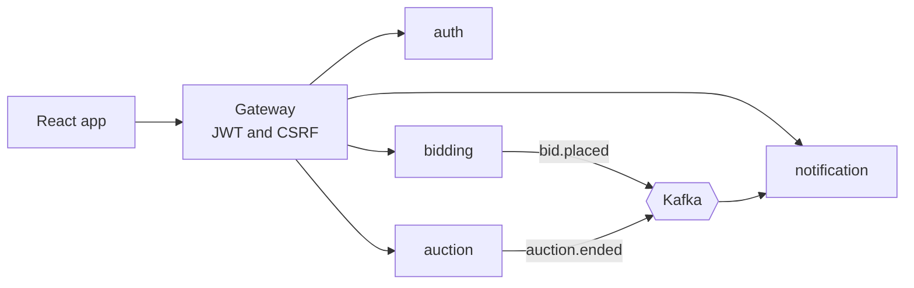

# Rostra

[](https://github.com/nethunirajapakse/rostra/actions/workflows/ci.yml)

A real-time auction platform built as event-driven microservices. Sellers list items with photos, bidders compete, and prices and notifications update live.

I built it to practise reliability patterns: not losing events when Kafka is down, not processing them twice, and not selling an item to two people.


**Stack:** Java 21, Spring Boot 3, Spring Cloud Gateway, Kafka, PostgreSQL, Redis, WebSocket, React 19, TypeScript, Tailwind 4

## Try it

You need Docker with Compose and about 4 GB of free memory.

```bash
docker compose --profile app up -d --build   # first build takes a few minutes
bash scripts/seed.sh                         # demo users, auctions, photos and bids
```

Open **http://localhost:3000** and sign in as `demo@rostra.dev` / `Rostra@Demo1`.

To see live bidding, open an auction in two browsers signed in as different demo users and place a bid in one. The price changes in the other straight away.

Running the services from an IDE instead? See [Development](docs/development.md).

## What it does

- Live bidding: the price updates on every open page, and people get notified when they are outbid or an auction ends.
- Photo uploads: up to 5 per auction, with a cover photo.
- Watchlist, search, sorting and status filters.

## How it fits together



Five Spring Boot services, each with its own database. They call each other over HTTP for commands and use Kafka for events.

## Things worth a look

| Problem | Solution |
|---|---|
| Kafka is down when a bid is placed | Transactional outbox: the event is saved with the bid, then published later |
| Kafka delivers an event twice | Consumers dedupe on the event id |
| Two bids at the same moment | Optimistic locking; a test fires 50 at once and exactly one wins |
| A downstream service is slow | Circuit breaker and retry |

Details: [Reliability](docs/reliability.md), [Authentication](docs/authentication.md), [Photo uploads](docs/photo-uploads.md).

## Project layout

```
platform/backend/    gateway, auth-service, auction-service, bidding-service, notification-service
platform/frontend/   React app
scripts/             db-reset, seed data, smoke tests, Kafka outage demo
docs/                detailed write-ups
docker-compose.yml   infrastructure and the optional full stack
```

## Tests

Each service has unit and integration tests (Testcontainers, so Docker must be running), and CI runs them on every push and pull request.

```bash
cd platform/backend/<service> && mvn verify
```

More in [Development](docs/development.md).

## Documentation

- [Architecture](docs/architecture.md): services, data and events
- [Reliability](docs/reliability.md): the failure cases and how each is handled
- [Authentication](docs/authentication.md): cookies, CSRF and token handling
- [Photo uploads](docs/photo-uploads.md): storage and validation
- [Development](docs/development.md): running from an IDE, reset and seed, tests

## Known limitations

- The schema comes from Hibernate `ddl-auto=update`; Flyway would be the proper fix.
- One shared secret signs all tokens; production would use asymmetric keys.
- WebSocket sessions are in memory, so notification-service is single-instance.
- No payments: winning produces a notification, not a checkout.
