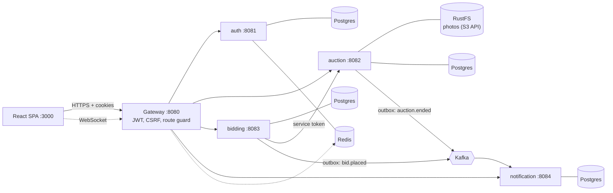

# Architecture

## Services

| Service | Port | Responsibility |
|---|---|---|
| gateway | 8080 | Single entry point. Validates the JWT cookie, enforces CSRF, blocks internal endpoints, proxies WebSocket |
| auth-service | 8081 | Sign-up, sign-in, refresh and sign-out |
| auction-service | 8082 | Auctions, photos, watchlist. Owns the auction price |
| bidding-service | 8083 | Validates and records bids, publishes `bid.placed` |
| notification-service | 8084 | Consumes events, stores notifications, pushes them over WebSocket |
| frontend | 3000 (5173 in dev) | React app, served by nginx in Docker |

## Data

Each service owns its own database: `rostra_auth`, `rostra_auction`, `rostra_bidding`, `rostra_notification`. No service reads another's tables. Redis holds the token denylist and refresh tokens. Photos live in an S3-compatible bucket (RustFS locally).

## Communication

- **HTTP** for commands. Bidding-service reads the auction and updates its price through auction-service, using a short-lived `SERVICE` token.
- **Kafka** for events. `bid.placed` (from bidding) and `auction.ended` (from auction) are consumed by notification-service.
- **WebSocket** from the browser, through the gateway, to notification-service for live updates.
